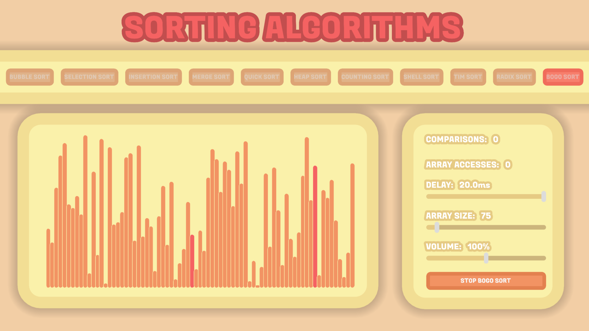
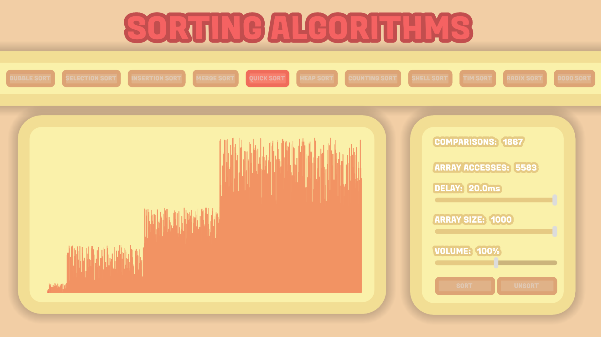

# **SORTIN ALGORIHMS**
#### GitHub repo: https://github.com/ADOGamedev/Sorting_Algorithms

#### Description: This is an application made in Godot 4.5. It allows you to mess around with different algorithms to sort a list.

## Usage

You must click **Unsort** to randomly shuffle the array. When you click **Sort**, the array will begin being sorted by the algorithm selected at the top.
The **Delay** slider controls how much time the visualization waits between each iteration.
To change the array size, use the **Array Size** slider.

> [!CAUTION]
> The maximum size is 1000, and in some devices, that amount of elememts can cause trouble.

> [!NOTE]
> For **Bogo Sort**, you will have a **Stop Bogo Sort** button to stop sorting whenever you want.

## Screenshots

